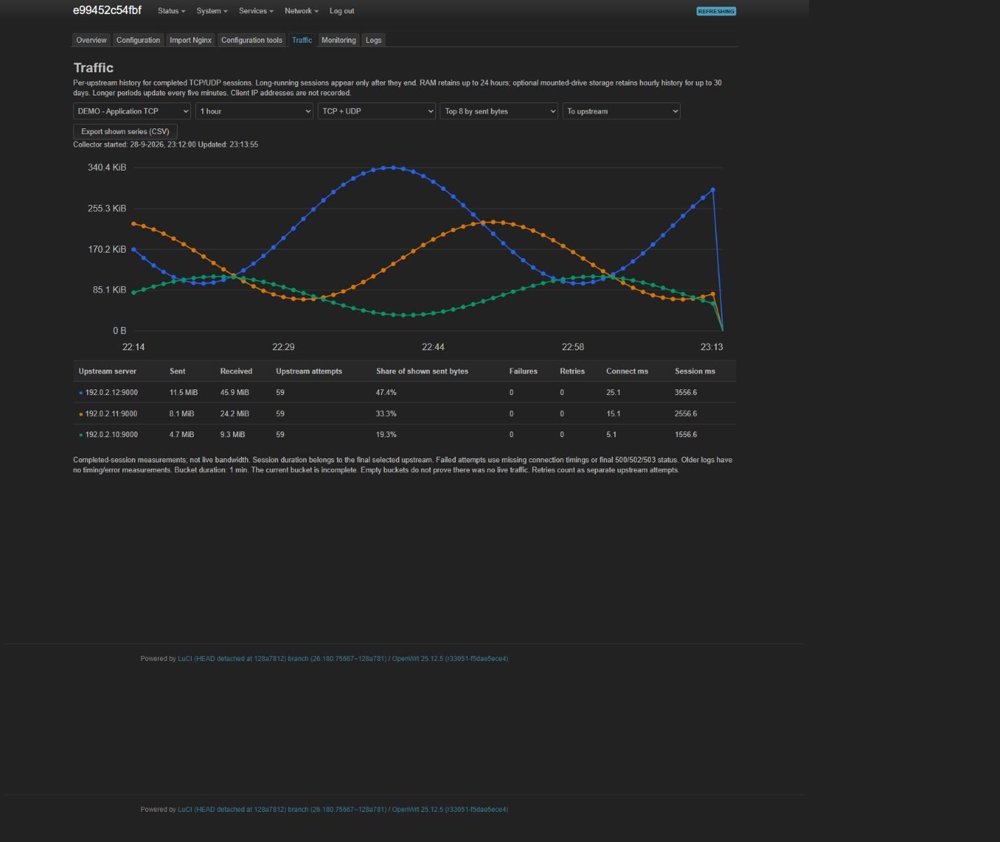
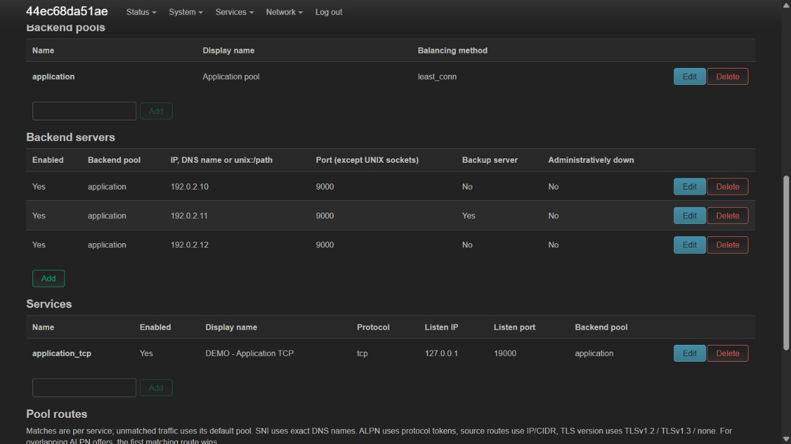

# Nginx Stream Manager 0.6.1

Generic LuCI application for TCP/UDP load balancing on OpenWrt, with optional client-IP preservation through `proxy_bind $remote_addr transparent`.

**This is locally validated source code, not yet a release tested on your OpenWrt router.** In addition to unit tests, real Nginx, nftables and UCI tests ran in a disposable container. Separate client and backend network namespaces confirmed TCP/UDP source-IP preservation for IPv4 and IPv6. The 0.6.1 APK packages were built with the 25.12.5 SDK and tested with real OpenWrt rpcd/procd, firewall4, TCP/UDP over IPv4/IPv6 and upstream traffic measurements on the host kernel. The 0.5.0 authenticated LuCI interface was checked in the browser, including configuration dialogs and the graph. The 0.6.1 pool, service and backend rename workflows have additional JavaScript view and OpenWrt RPC tests. The earlier 0.2.1 version was also tested as a 24.10.5 IPK. The target router, reboot and full on-device operation remain separate acceptance tests. See [test results](docs/TESTING.md), [build instructions](docs/BUILDING.md) and the [0.2.1 technical review](docs/REVIEW-0.2.1.md).

## Features

New in 0.6.1: rename individual backend IDs, including imported `imp_...` names, under **Configuration tools → Rename service, pool or backend**. Preview the change, then commit with the manager stopped. Backend settings and traffic history are preserved.

New in 0.6.0: rename backend pool and service IDs from **Configuration tools**, with a preview and automatic reference updates. Display names remain editable through **Configuration → Edit**. See [renaming pools and services](docs/OPERATIONS.md#renaming-pools-and-services--060).

New in 0.5.0: active TCP/TLS/DNS probes, health and certificate alerts, error/timing graphs, optional history on a mounted drive, CSV/Prometheus export, configuration snapshots with restore/import/duplication, wildcard SNI with a route test and a diagnostics page. See [monitoring and management](docs/OPERATIONS.md) for settings, limitations and recovery procedures.

New settings and procedures are in [OPERATIONS.md](docs/OPERATIONS.md); current validation is in [TESTING.md](docs/TESTING.md).

New in 0.4.0: extended failover/balancing, DNS/UNIX upstreams, TLS termination and upstream TLS, SNI/ALPN/client-network routing, incoming PROXY protocol, connection limits and socket options. See the [feature and compatibility overview](docs/STREAM-FEATURES.md), including limitations of the OpenWrt stream module.

- LuCI: overview, configuration, service management, configuration preview, validation, live logs and import of existing Nginx streams.
- Freely configurable TCP, UDP and combined services.
- Reusable backend pools with weights, backup servers, manual down status, maximum connections and passive failure detection.
- Round-robin, least-connections and consistent hashing on client IP.
- IPv4 and IPv6; a separate service per listening address/family.
- Transparent upstream connections, targeted socket marking and policy routing for return traffic.
- Optional firewall input permits per service, client interface and client CIDR.
- Client CIDR access control in Nginx, independent of firewall permits.
- TCP keepalive, half-close, PROXY protocol v1 to compatible TCP backends.
- UDP session limits and an optional expected number of replies.
- Timeouts, per-connection rate limits, error logs and optional access logs.
- Traffic graphs per load balancer and upstream server, showing sent/received bytes from completed TCP/UDP sessions and up to 24 hours of history in RAM.
- Dedicated Nginx instance under procd; automatic restart after a crash.
- Log rotation and a viewer that reads only the tail, limited to 8,000 bytes per request.
- Package dependencies, kernel modules, installation/removal scripts, OpenWrt package sources and tests.

## Screenshots

Real LuCI 0.5.0 interface in a local OpenWrt 25.12.5 test container. The graph contains **synthetic demo data**, not router traffic.

View [all seven main tabs, six service tabs and the connection-time graph](docs/SCREENSHOTS.md).





Also see the [overview and TLS/SNI settings](docs/SCREENSHOTS.md).

## Quick installation

Extract the archive on a computer and copy the directory to the router, for example with SCP. Run there:

```sh
cd /tmp/nginx-stream-manager
sh install.sh
```

The installer detects `apk` or `opkg`, installs dependencies and adds the application. The application and script do not write to your existing `/etc/nginx/nginx.conf` or `/etc/config/network`. Dependency installation may run the package manager's own package scripts, including Nginx service management; check which Nginx variant is installed beforehand. The installer preserves an existing Nginx provider. It reloads firewall4 and restarts rpcd to activate the new integration. Then log out of LuCI and back in.

Menu: **Services → Stream Manager**.

The manager is **disabled** on a fresh installation. Installation does not start new proxy listeners. Its UCI configuration is preserved on reinstallation. Stop the manager before updating an existing installation.

Dependencies:

```text
luci-base nginx-mod-stream python3 ip-full
nftables-json firewall4 kmod-nft-socket
```

This version uses Python 3 for the backend. This simplifies validation and testing but needs more storage than a ucode backend. Check free space on small routers. Kernel modules must come from feeds matching your running kernel exactly. Never force a different kernel version to bypass an installation error.

An Nginx provider and rpcd are also required. The manual installer adds `nginx-full` if no Nginx binary is present; the package declares the virtual dependency `nginx`. `kmod-nft-socket` pulls in `kmod-nf-socket` automatically. No TPROXY modules are added.

## Traffic graphs in 0.3.0

Enable **Configuration → Traffic history** for the desired service. Select **Save & Apply** and start/reload the manager through Overview. Then open **Traffic** and select the load balancer, period (1/6/24 hours), protocol and upstream server. You will see sent and received bytes and their distribution across upstream servers.

The graph processes **completed sessions**; it is not a live Mbit/s meter. Long-running TCP connections appear only after closing, and UDP appears after the Nginx session ends. History is stored in RAM, is bounded and is lost on reboot. This feature is disabled by default and records no client IP addresses. See [operation and limitations](docs/TRAFFIC.md).

## Upgrading from an earlier version

Stop Stream Manager before running the new installer:

```sh
/etc/init.d/nginx-stream-manager stop
sh install.sh
```

Existing application configuration is preserved. Sign in to LuCI again to load the new RPC permissions and import view. To import, also disable **Enable manager** and apply that change. Your existing manually managed Nginx instance does not need to stop for this.

Do not mix the manual installer and package management: the scripts now refuse to overwrite or remove a package installation. OpenWrt package hooks may restart an enabled configuration after a package upgrade; disable the manager beforehand if that is unwanted. The 0.2.1 removal hook preserves the boot preference during upgrades. The **old 0.2.0 hook** did disable boot start: check that preference after upgrading from that version. OpenWrt may create a boot symlink for a new package installation, but the default UCI configuration remains disabled.

## Importing an existing Nginx configuration

New in 0.2.0: **Services → Stream Manager → Import Nginx**.

1. Keep Stream Manager stopped and disabled.
2. Select **Read nginx.conf and preview**.
3. Check services, backend pools, source-IP preservation and any blocking messages.
4. Select **Import disabled services** and confirm the specific preview.
5. Review the imported configuration. For transparent services, add return interfaces and confirm the backend return route only after checking it.
6. Migrate the old listeners and TPROXY rules, then activate the desired services.

The source file `/etc/nginx/nginx.conf` is read only. Import adds application configuration, creates a backup and does not start or reload Nginx processes. Unsupported stream settings block import. External includes are not followed in this version.

## Setting up the first service

1. Create a backend pool, for example `application`, and save it.
2. Add backend servers with their IP addresses and ports. Hostnames are deliberately unsupported in this version to keep addresses predictable for transparent routing.
3. Create a service with a unique technical ID, for example `application_tcp`. Use letters, digits and underscores. `manager` is reserved.
4. Choose the protocol, listening address, listening port and backend pool.
5. Initially leave source-IP preservation disabled to test ordinary forwarding.
6. Optionally enable **Manage firewall input permit** and specify explicit Linux client interfaces, for example `br-lan`. These are not UCI network names such as `lan`.
7. Optionally specify allowed client CIDRs. An empty list means Nginx allows all clients admitted by the firewall.
8. Enable **Enable manager** and select **Save & Apply**.
9. Check **Overview** and the manager log. Use **Start** if the service is not running yet.
10. Enable **Enable at boot** once the configuration works.

`Save` alone stores LuCI changes in the session. Preview and Validate read the **committed UCI configuration**, not unapplied form values. `Save & Apply` commits and triggers the service. A rejected configuration can therefore be present in UCI while the old runtime configuration remains active; the error appears in Overview.

## Preserving source IPs

See [docs/TRANSPARENT.md](docs/TRANSPARENT.md) for the full explanation.

For each transparent service:

- choose a non-loopback listening address;
- use backends with the same IP family as the listener;
- enter the Linux interfaces on which backend replies reach the router;
- verify the return route from backends to clients;
- only then confirm **Backend return route verified**.

The application manages table `inet nsm`, routing table `20100`, rule priority `10100` and mark bit `0x40000000`. These values are reserved for the application. Do not also use them for mwan3, PBR or other custom rules. The application checks occupancy of the routing table and priority on first activation; a full conflict analysis of all external mark users is not possible.

Preservation concerns the **source IP**, not the original source port. If a backend shares the client's L2 subnet, merely setting its default gateway to the router is insufficient: replies may go directly to the client. A separate backend VLAN is usually easier to manage.

## Firewall management

The application uses the official firewall4 `chain-pre/input` include and its own nftables table for return marking. An optional service permit is limited to:

- the specified client interfaces;
- the IP family and optionally the specific listening address;
- protocol and listening port;
- optional client CIDRs.

When such permits change, the application checks and reloads firewall4. Generated permits are removed on stop. Existing firewall rules are not removed: a broad ACCEPT elsewhere remains effective. Nginx CIDR checking therefore remains available too.

WAN access is not opened automatically. For public access, deliberately specify the correct ingress device or manage a suitable firewall rule yourself. The OUTPUT policy must also allow router traffic to the backends.

## Nginx alongside existing services

The application uses the same Nginx binary and stream module, but a separate master with:

```text
config:  /var/run/nginx-stream-manager/nginx.conf
pid:     /var/run/nginx-stream-manager/nginx.pid
state:   /var/run/nginx-stream-manager/state.json
logs:    /var/log/nginx-stream-manager/
```

LuCI/uhttpd and existing Nginx websites remain separate. Identical IP:port/protocol listeners must not be managed by the old and new instances simultaneously. With `reuseport`, Linux can distribute the same listener across both processes; this is not a safe migration. Stop the old listener first. Duplicate identical listeners within this application are detected before apply. Specific addresses, such as loopback, may coexist with a wildcard on the same port; the generator uses explicit socket binding and reuseport for this. Preflight now also checks external TCP/UDP sockets through `/proc/net`, excluding the application's own Nginx sockets. External IPv6 wildcards are conservatively treated as potentially dual-stack for IPv4. This snapshot does not reserve ports: a process can still bind afterwards. `nginx -t` alone does not prove that a port is free.

A reload gives old workers at most 15 seconds to finish. Long-running connections and UDP sessions may therefore be interrupted. Changes to return rules may affect old transparent sessions sooner. This is not a hitless configuration change or a highly available cluster.

## Migrating a manual configuration

1. Save your current Nginx configuration, firewall includes and network configuration.
2. Use **Import Nginx** to preview inline stream configuration and import it as disabled services. See [docs/IMPORT.md](docs/IMPORT.md). Alternatively, create the pools and services manually.
3. Optionally test on an available high listening port with source-IP preservation disabled.
4. Remove only the stream listeners being migrated from the old Nginx configuration; reload that existing instance.
5. Disable old TPROXY includes that overlap with the migrated services. Do not leave broad port-interception rules alongside the new application.
6. Remove only the old network rules/routes you added for that manual setup, once they serve no other purpose.
7. Activate the application and test from a real client. Check which source IP reaches the backend and whether replies return.

The installer does not perform this migration automatically. A script cannot reliably determine which existing rules are also used by other services.

## Operation through SSH

```sh
/etc/init.d/nginx-stream-manager start
/etc/init.d/nginx-stream-manager reload
/etc/init.d/nginx-stream-manager stop
/etc/init.d/nginx-stream-manager enable
/etc/init.d/nginx-stream-manager disable

/usr/libexec/nginx-stream-manager validate
/usr/libexec/nginx-stream-manager preview
/usr/libexec/nginx-stream-manager status
ubus call luci.nginx-stream-manager logs '{"service":"manager","kind":"error","lines":100}'
```

`preview` through RPC bounds output for ubus. All RPC responses remain below 60,000 serialized bytes; an oversized response produces an error. The complete active Nginx configuration is at the runtime path above.

LuCI service buttons start a separate, serialized background action. “Action accepted” confirms only the request; **Overview** subsequently shows completion or failure through `status.operation`. This prevents rpcd from terminating a long service action because of its request timeout. SSH init commands remain synchronous.

### What start, reload and rollback confirm

Start waits for observed Nginx workers. Reload waits for new worker PIDs that remain present for at least half a second. This is a process check, not proof that every listener works or a backend is reachable; a concurrent worker respawn can produce the same observation.

On failure, the application attempts to restore the previous configuration file, network and firewall rules. The recovery reload is also checked for workers. Firewall recovery reloads the previous snippet even if the previous firewall reload had already partially run. The UCI configuration itself is **not** rolled back on runtime errors. Nginx, policy routing and firewall4 do not form an atomic transaction: existing sessions may be lost and external changes may prevent recovery.

An interrupted apply or failed recovery leaves `pending.json` containing the involved IP families. Subsequent applies and hotplug recovery are then refused. Stop the manager, inspect the error in Overview and check routes and firewall. Stop cleans up only after Nginx has exited; if cleanup also fails, ownership files are retained for another attempt. Do not delete those files blindly.

## Building packages

For a reproducible local SDK build, package-content inspection and testing with real OpenWrt service processes, see [docs/BUILDING.md](docs/BUILDING.md). Obtain the router inventory with `sh tests/router-info.sh`; that script only reads version and architecture information.

No prebuilt or signed `.apk`/`.ipk` is included. The manual installer works without an SDK. For normal package distribution:

1. Use the SDK/buildroot matching your OpenWrt release.
2. Ensure the `packages` and `luci` feeds are present and dependencies are installed in the build tree.
3. Copy both directories from `packages/` to the SDK's `package/` directory.
4. Select `nginx-stream-manager` and `luci-app-nginx-stream-manager` in `make menuconfig`.
5. Build:

```sh
make defconfig
make package/nginx-stream-manager/compile V=s
make package/luci-app-nginx-stream-manager/compile V=s
```

Build output follows your SDK's package format. The backend Makefile uses the standard OpenWrt package infrastructure; the LuCI Makefile uses `feeds/luci/luci.mk`. Build these packages in a matching SDK, not with ordinary desktop `make`.

## Removal

For a manual installation:

```sh
sh uninstall.sh
```

This stops the application, cleans up its active routing and firewall permits, removes application files and preserves UCI configuration, logs and shared dependencies. If you installed real packages, remove them through the package manager instead of this script.

## Limitations of version 0.2.1

- No interception of arbitrary transit traffic through TPROXY.
- No HTTP URL routing, TLS termination, certificate management or SNI routing; TLS passthrough works as ordinary TCP traffic.
- No active protocol-specific health checks or Nginx Plus API.
- No hostname backends or automatic DNS re-resolution.
- No automatic route changes on external backends.
- No automatic sysctl changes; `rp_filter` considerations appear in status.
- No live Nginx Plus statistics; the overview shows applied services, not invented health status.
- Python backend; no guarantee this fits on a router with very limited flash storage.
- Built for modern OpenWrt with firewall4 and JavaScript LuCI; specific release compatibility must be tested on the target device.

See [docs/TESTING.md](docs/TESTING.md) for reproducible tests and the router acceptance procedure.
